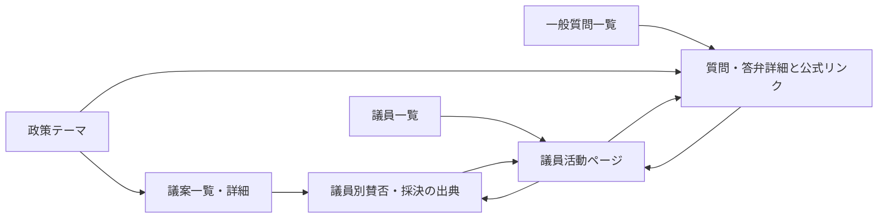

# みらい議会・三島市版：議員活動可視化機能の実現可能性調査

調査基準日：2026年11月24日（日本時間）。作成：Codex。議員や政策の優劣を評価する資料ではない。

対象：`mishima-migration`、`fd0379fa12b5c361fd4a161b2179d166b0fedf69`。既存worktreeで調査した。READMEと[別地域向けFork手順書](kawasaki/20260304_1000_別地域向けfork手順.md)を参照し、現行のWindows手順・JSON構成を優先した。Fork手順のDB・seed例は今回は実行していない。

本書のみ新規作成。アプリ、原本、依存関係、設定は変更していない。コミット・push、デプロイ、Git連携、外部問い合わせ、有料API利用は未実施。調査用PDF・HTML・解析用依存はリポジトリ外のWindows一時フォルダー `mishima-feasibility-20261124` に置き、本文や写真を新たに本リポジトリへ追加していない。本書中の要旨は**Codexによる検証用AI要旨・人による校閲前**であり、公開用の承認済みコンテンツではない。

## 1. エグゼクティブサマリー

**統合した議員活動ページは段階的に実現可能。最初は22人の議員ID・出典台帳を整え、本文を配布しない名簿／活動ページの土台を作ることを推奨する。** その上で、個人別賛否が明記された9議案と、6月の一般質問16人の実施履歴を追加する。

主な実証結果：

- 市議会だよりの個人別賛否表を、文字抽出とPDF画像の両方で確認。5月の承第5号、9月の8議案の計9件は既存62件に対応する。全会一致から他の議案の個人票を推定しない。
- 9月の認第1号には「退席」、表には議長の不参加が明記される。賛成・反対の二択では不正確になる。
- 6月18・19・22・23日の会議録から実際の一般質問16人を確認。通告一覧とも一致。再質問を別の登壇として数えない。
- 6月18日分の保存済み129項目は、現在の公式APIの同日129項目とID・見出し・本文が全件一致した。7日分すべての現在版照合を行ったわけではない。
- 9月は通告15人を確認したが、今回取得した会議録索引に9月本会議はない。11月通告18人は11月26日以降の予定であり、11月24日現在の実績にしない。
- 会議録索引は1996年6月までの項目がある。ただし全期間の本文・名簿・個人票が揃うという意味ではない。
- 会議録全文のGitHub再配布条件は未解決。新機能が実現可能でも、サイト全体の**一般公開保留を解除する根拠にはならない**。

### 機能別の判定

判定は技術だけでなく、資料の範囲を付記する。複合機能は「事実部分」と「本文・画像利用部分」を分けた。

| 機能 | 区分 | 範囲・条件 |
|---|---|---|
| 議員ID、氏名、名簿リンク、現時点の所属・期数 | 現在の公式データで実装可能 | 22人。所属・期数は資料の日付付きスナップショット |
| 個人別賛否、分裂議案抽出、マトリクス | 現在の公式データで実装可能 | 明示された9議案。残りを推定で埋めない |
| 人数・割合グラフ、議員別履歴 | 現在の公式データで実装可能 | 確認範囲と分母を明示。全62件の個人票の完備ではない |
| 62件すべての正確な個人票、過去任期の賛否 | 追加調査・データ取得により実装可能 | 個人記録が存在する部分に限る。全会一致からの補完は不可 |
| 6月の一般質問実施履歴・実施マトリクス | 現在の公式データで実装可能 | 会議録で実施を確認した16人 |
| 9月以降の実施履歴、代表質問との区別 | 追加調査・データ取得により実装可能 | 会議録・録画の公開待ち／照合。通告だけでは実績にしない |
| 質問項目検索、公式リンク、手動政策分類 | 現在の公式データで実装可能 | 最小限の項目・事実から開始。分類は編集判断と明示 |
| 質問・答弁・再質問の対応付け | 追加調査・データ取得により実装可能 | 6月に実例あり。全件の話題境界・複数答弁者の検証が必要 |
| 質問・答弁の要旨公開、討論要旨 | 外部確認・許諾等が必要 | 表現の利用範囲・法定例外・要旨品質を確定。常に許諾必須との断定ではない |
| 全文表示・全文JSON配布、議員写真 | 外部確認・許諾等が必要 | 現行の公開GitHubを含め別途解決。写真は初期不使用 |
| 歴史的会派・委員会所属、任期切替 | 追加調査・データ取得により実装可能 | 日付付き名簿がある範囲。現在の会派を遡及しない |
| 政策別横断検索・時系列の関連表示 | 追加調査・データ取得により実装可能 | 共通テーマIDと人による関連確認。因果関係とは扱わない |
| 行政方針の進捗追跡 | 追加調査・データ取得により実装可能 | 事後の予算・実績資料と照合した項目のみ |
| 記録のない個人票復元、全自動の正確なQ&A、議員の成果の因果判定 | 現時点では実装困難 | 資料にない判断・約束・成果を生成しない |

「2026年」は暦年2026年1～12月、「2026年度」は2026年4月～2027年3月。既存62件は後者で、2月定例会は含まれない。初期実装は**既存の2026年度・調査時点まで**とし、暦年表示を導入する場合は2月分を別途追加する。2027年3月分を2026年の実績と混同しない。

## 2. 公式資料の調査結果

以下はHTTP取得・本文確認済み。PDFは一時保存しPDF.jsで文字抽出した。主要な賛否表はレンダリング画像でも目視照合した。自動取得できたことと利用許諾を得たことは別である。

| 資料 | 確認内容と使い道 |
|---|---|
| [議案・議決結果一覧](https://www.city.mishima.shizuoka.jp/site/gikai/list216-519.html) | 会期、議案番号・件名・議決日・結果、公式PDF。個人票の専用一覧ではない |
| [2026年8月1日号](https://www.city.mishima.shizuoka.jp/site/gikai/35181.html) | 5月・6月の議決結果と6月の一般質問。発行月と対象会期を分離する |
| [同号6・7頁PDF](https://www.city.mishima.shizuoka.jp/uploaded/attachment/16292.pdf#page=1) | 1枚に印刷上の7頁・6頁。5月承第5号の22人の賛否、6月全会一致一覧、一般質問16人の記述 |
| [2026年11月1日号](https://www.city.mishima.shizuoka.jp/site/gikai/38174.html) | **9月定例会**の結果。11月定例会の結果ではない |
| [同号6・7頁PDF](https://www.city.mishima.shizuoka.jp/uploaded/attachment/17617.pdf#page=1) | 1枚に印刷上の7頁・6頁。分裂8議案の22人の個人票と全会一致17件 |
| [同号8・9頁PDF](https://www.city.mishima.shizuoka.jp/uploaded/attachment/17618.pdf#page=1) | 一般質問の編集済みQ&A。全文でも全質問・全再質問の網羅資料でもない |
| [議会だより一覧](https://www.city.mishima.shizuoka.jp/site/gikai/list220-525.html) | 今回の一覧で2021年5月1日号～2026年11月1日号の24項目。全号の個人票抽出は未実施。最古の保存資料と断定しない |
| [一般質問一覧](https://www.city.mishima.shizuoka.jp/site/gikai/list216-521.html) | 今回の一覧では2022年6月～2026年11月の23項目。代表質問の資料もあるので種別を保持 |
| [6月通告](https://www.city.mishima.shizuoka.jp/site/gikai/33369.html) | 6月18～23日の予定16人、各人の通告PDF・一括PDF |
| [9月通告](https://www.city.mishima.shizuoka.jp/site/gikai/36772.html) | 9月24・25・28・29日の予定15人。実施確定には会議録等が必要 |
| [11月通告](https://www.city.mishima.shizuoka.jp/site/gikai/39007.html) | 11月26日～12月2日の予定18人。調査基準日には将来の予定 |
| [公式会議録検索](https://ssp.kaigiroku.net/tenant/mishima/SpTop.html) | 索引で1996～2026年、最古の掲載会期は1996年6月。現在の2026年本会議は2月・5月・6月。委員会も別種別で存在 |
| [議会中継・録画入口](https://smart.discussvision.net/smart/tenant/mishima/WebView/rd/council_1.html) | 公式導線とHTML到達を確認。全動画の再生、公開年限、個人別開始時刻、恒久URLは未確認 |
| [議員名簿カテゴリ](https://www.city.mishima.shizuoka.jp/site/gikai/list217-544.html)・[名簿本文](https://www.city.mishima.shizuoka.jp/site/gikai/4585.html) | 議席番号順PDFと写真入りPDFへリンク。個人別HTMLプロフィールを全員分取得できたわけではない |
| [議席番号順名簿PDF](https://www.city.mishima.shizuoka.jp/uploaded/attachment/14980.pdf#page=1) | 2026年5月15日現在の22人、氏名・かな・期数・備考等。住所・年齢は初期データに採用しない |
| [会派別名簿](https://www.city.mishima.shizuoka.jp/site/gikai/4630.html) | 2026年5月20日時点。会派は政党と別。氏名の諒／涼など資料間差異あり |
| [委員会一覧](https://www.city.mishima.shizuoka.jp/site/gikai/list217-524.html) | [常任委員会](https://www.city.mishima.shizuoka.jp/site/gikai/22457.html)、[議会運営](https://www.city.mishima.shizuoka.jp/site/gikai/4629.html)、[新庁舎特別委員会](https://www.city.mishima.shizuoka.jp/site/gikai/30630.html)への導線。常任委員会・運営委員会の本文を確認 |
| [県の任期一覧](https://www.pref.shizuoka.jp/kensei/senkyo/senkan/1032132.html) | 三島市議の任期満了2027年4月30日。開始日・途中就退任は別の選挙／議会資料と合わせて確定する |
| [参考として指定された10667.pdf](https://www.city.mishima.shizuoka.jp/uploaded/attachment/10667.pdf#page=4) | **2025年11月4日付の新庁舎資料**。PDF4枚目は2025年6月議案第47号の個人票。2026年の議第47号とは別件 |

CMSの「更新日」は移行等でも変わる。発行日、会期、実施日、採決日、取得日を別フィールドに保存する。

## 3. 議員別賛否データの取得可能範囲

### 現在の62件との対応

| 範囲 | 議案数 | 個人票の確認状況 |
|---|---:|---|
| 5月臨時会 | 5 | 承第5号の1件に22人の表。他4件は全会一致欄 |
| 6月定例会 | 14 | 全会一致欄。今回確認した広報紙には個人票の一覧なし |
| 9月定例会 | 25 | 分裂8件に22人の表。他17件は全会一致欄 |
| 11月定例会 | 18 | 既存データの結果未掲載。将来の採決を推定しない |
| 合計 | 62 | **個人表あり9件、全会一致だが個人表なし35件、結果未掲載18件** |

これは既存JSONと今回確認した2号の対応であり、市に別の個人別記録が存在しないという断定ではない。全会一致35件の各議員は `unreported`、11月の未採決・未確認は別の `pending` 状態。いずれも賛成・欠席・一般的な「その他」に置き換えない。

9件の内訳：承第5号、認第1・2・3・4・8号、議第54・62・63号。62号・63号の議決日は9月4日、認定5件と54号は10月2日、承5号は5月15日と既存JSONで照合した。9月会期でも採決日が10月になる。

### 抽出方法

| 方法 | 実現性 | 精度・運用 |
|---|---|---|
| PDF文字とセル座標 | 高い。今回のPDFには文字層あり | 縦書き・結合セル・斜線は本文順だけで復元不可。○と〇の正規化、列名・座標・罫線の照合が必要 |
| 半自動抽出＋画像照合 | **初期推奨** | 機械で候補を作り、全セルを担当者が確認。22人×9議案=198セル。OCRは文字層がない資料に限る |
| 手入力 | 初期9件なら現実的 | 出典ページ付き二重入力／差分照合。行・列ずれを防ぐ独立チェックを置く |
| 会議録 | 補助資料 | 起立多数・全員起立だけでは氏名別の復元不可。記名投票の名簿等が明記された場合のみ個人票に使う |
| 動画 | 補助・手動検証 | カメラ外、議席移動、採決直前の退席などがある。映像認識から推定票を自動生成しない |

議長の斜線はPDFの**凡例が根拠**であり、空欄一般を議長と推定しない。欠席・棄権・退席・除斥は資料に明記された種類だけを登録。討論の賛否は投票行動の代用にしない。

2025年の参考資料には賛成13・反対8・欠席1でも「否決」とある。所在地条例は[地方自治法4条3項](https://laws.e-gov.go.jp/law/322AC0000000067)の特別多数決が関係する。単純な賛成率から議決結果を算出してはならない。通常の議長不参加と可否同数時の扱いも同法116条を踏まえ、公式結果を優先する。

履歴拡張は2021年以降の広報紙各号から候補を作り、当時の議員名簿で確認する。1996年まで会議録があっても、その期間の個人票を全件取れるとは確認していない。古い名簿・欠員・補選・会派移籍日は追加調査事項。

## 4. 一般質問・行政答弁データの取得可能範囲

通告HTML・個別PDF→予定、会議録の一般質問議題内の議員紹介と本人発言→実施、録画→補助確認、広報紙→編集された概要、という優先関係にする。広報紙の省略されたテーマを「質問なし」にしない。

**今回の実績確認範囲は6月の4日間・16人。** 9月の通告15人は予定データとして取得可能だが、会議録索引にはまだ9月本会議がなく、実績・答弁の全件確認は未完了。11月18人は未来の予定。2月は暦年2026年に含まれるが現行2026年度原本の外であり、実績集計していない。

質問と答弁は「同じ議員の一連の発言」より細かく分割する。1問に複数の答弁者が対応する場合、再質問が前の話題へ戻る場合、答弁を伴わない要望・議長進行がある。単純な交互並び、最初の部長を全テーマに適用する方式は採用しない。

### 集計の定義案

- 通告人数：当該会期の一般質問通告者の人数。撤回・変更は履歴に残す。
- 実際の登壇回数：一般質問議題内で、議員への発言許可から終了までの1回の質問枠を1回。質問席での再質問や休憩再開を加算しない。日をまたぐ継続は同じ枠かを人が確認する。
- 実施者数：登壇した異なる議員の人数。登壇回数とは別集計。
- 通告テーマ数：通告の大項目数。小項目・再質問数と別。実際に扱われたテーマ数は本文で照合したものだけ。
- 再質問回数：原文の質問発言単位と、対応確認済みの実質的な質問ターンを分ける。感想・謝辞・要望を自動で質問1件にしない。
- 一般質問、代表質問、議案質疑、賛否討論、委員会発言は別種別。

全4日の一般質問枠を確認した6月に限り、登壇の見つからない6人を0回とできる。「資料未取得」の会期は `unknown`、「開催前」は `scheduled`、「対象外／当時非議員」は `not_applicable` とし、0と区別する。

本文の配布をせずに、質問者、日付、テーマの簡潔な整理、実施回数、公式リンク、手動分類による検索は作れる。ただし「本文を公開しない」ことは、長い原文を要旨欄に貼ることの正当化にはならない。原文に近い要約、引用、写真、全文利用は14節の確認を経る。

## 5. 福岡市版・本家・その他先行事例の比較

公開リポジトリの特定コミットを読み取った。以下の上流skillファイルは**研究対象の文書**として読んだもので、そのDB更新操作を今回実行したものではない。

| 事例 | 確認した構成 | 流用・注意 |
|---|---|---|
| [福岡市版](https://github.com/bakumon1107/mirai-gikai-fukuoka-city/tree/8dd16939c8fe1734d5945d37b37b12373b3289d9) | `fukuoka-city/develop`、調査時SHA `8dd16939c8fe1734d5945d37b37b12373b3289d9`。AGPL-3.0。会期別質問一覧、政策カテゴリ、個人質問ページ、質問／答弁表示、要約／原文切替。Supabaseの `general_questions` に `raw_text` と `topics` | UIと純粋関数は候補。全文表示、DB接続、福岡用取得処理はそのまま有効化しない |
| [本家リポジトリ](https://github.com/team-mirai-volunteer/mirai-gikai/tree/e3f323f5777a32713e1e431f14ea57c0edc0d7fb)・[公開サイト](https://gikai.team-mir.ai/) | `develop`、SHA `e3f323f5777a32713e1e431f14ea57c0edc0d7fb`、AGPL-3.0。国会法案、政策タグ、難易度別コンテンツ、AIインタビュー、Supabaseの公開状態・日時制御 | 分類・公開管理・議案UIは参考。三島の個人票／一般質問の完成済み機能としては扱えない |
| [熊本市議会の議員詳細](https://kumamoto-shigikai.jp/namelist/pub/detail.aspx?c_id=3&mem_id=148&lsttype=1) | 一人のページに期数・会派・委員会と議案別賛否を集約 | 統合活動ページの具体例。ただし「－」が議長・欠席・除斥・退席を一括表現。三島で詳細理由が不明な「－」を分解しない |
| [岡山市の議案賛否](https://www.city.okayama.jp/gikai/0000078068.html) | 公式説明で起立採決を行った議案の議員別賛否が対象 | 資料の対象範囲を明示する例。掲載外の議案まで完全性を拡張しない |
| [議員レコード](https://giinrecord.jp/assemblies) | 自サービスの調査ページで個人票、会派別、総数のみ、不明を分け出典を付ける | 取得可能性の表示が参考。他自治体の事実はリンク先の公式資料で再確認。サービスの存在だけを転載許諾の根拠にしない |

### 福岡市版の取得・保存・公開方法

[一般質問設計資料](https://github.com/bakumon1107/mirai-gikai-fukuoka-city/blob/8dd16939c8fe1734d5945d37b37b12373b3289d9/.claude/skills/general-questions/SKILL.md)と[更新手順](https://github.com/bakumon1107/mirai-gikai-fukuoka-city/blob/8dd16939c8fe1734d5945d37b37b12373b3289d9/.claude/skills/update-general-questions/SKILL.md)で次を確認した。

- 福岡独自の会議録サイトから、一時IDとcookieを扱い、会期の全日程を取得して一般質問を判別する。
- 会期の全文作業ファイルはgitignoreされたローカル領域に保存する手順。一方、質問者単位の原文はDBの `general_questions.raw_text`、議案質疑は `question_raw`／`answer_raw` に保存する設計。
- 公開UIは要約と原文の切替を持つ。質問トピックの原文内位置をターン数の比例配分で近似する実装説明がある。三島で正確な質問答弁対応の根拠として採用しない。
- `source_url` は一時URL対策でnull運用との記載がある。三島では公式会期・日程のURL、該当ID、フォールバックの入口を必須にする。
- リポジトリのツリーには `docs/data/committee-minutes/2026` のJSONも存在する。「福岡版は全種類の本文をGitに一切残さない」と一般化できない。今回、全JSONの権利・内容・本番DBを監査したわけではない。
- `faction_stances` は**会派別**の態度。個人別投票の根拠として転用不可。
- AI要約を作成後、ユーザーに提示・確認してDBに書く手順がある。ただし本書で確認した設計・更新文書から、三島の全文再配布に使える許諾は得られない。

本家はコード・規約・公開画面を確認した範囲。元資料すべての保存場所、本番DB、国会会議録の個別利用許諾までは確認していない。本家の利用者向け規約やインタビューデータの同意条件は、三島市議会の発言の再配布許諾とは別である。

## 6. 実データの抽出・検証結果

### 6.1 議員別賛否の実例

以下は**実在する議案の事実抽出**。仮の投票ではない。PDFの文字抽出だけでは斜線が落ちるため、[16292.pdfの印刷6頁](https://www.city.mishima.shizuoka.jp/uploaded/attachment/16292.pdf#page=1)と[17617.pdfの印刷7頁](https://www.city.mishima.shizuoka.jp/uploaded/attachment/17617.pdf#page=1)を画像で確認した。人による公開前の二重照合はまだ実施していない。

| 議案 | 採決日 | 公式結果 | 賛成 | 反対 | 退席 | 議長不参加 |
|---|---|---|---:|---:|---:|---:|
| 2026年5月・承第5号（国民健康保険税条例の専決処分承認） | 5月15日 | 承認 | 19 | 2 | 0 | 1 |
| 2026年9月・認第1号（2025年度一般会計決算認定） | 10月2日 | 認定 | 17 | 3 | 1 | 1 |
| 2026年9月・認第2号（2025年度国民健康保険特別会計決算認定） | 10月2日 | 認定 | 19 | 2 | 0 | 1 |

「2025年度決算」の採決は2026年度である。件名の年度を採決年度として結合しない。

#### 複数議案のマトリクス（22人・3議案の検証サンプル）

○=賛成、×=反対、退=退席、議=資料の斜線・議長不参加。PDFごとに列順が違うので、氏名で対応させた。氏名の空白と○／〇を正規化したが、同一人物の根拠は名簿・議席番号・公式表を併用した。

| 議員 | 5月・承5 | 9月・認1 | 9月・認2 |
|---|:---:|:---:|:---:|
| 永田裕二 | ○ | ○ | ○ |
| 野村諒子 | ○ | ○ | ○ |
| 土屋利絵 | ○ | ○ | ○ |
| 横山雅人 | ○ | ○ | ○ |
| 髙田康子 | ○ | ○ | ○ |
| 古長谷稔 | ○ | ○ | ○ |
| 藤江康儀 | ○ | ○ | ○ |
| 沈久美 | ○ | ○ | ○ |
| 秋山恭亮 | ○ | ○ | ○ |
| 宮下知朗 | ○ | ○ | ○ |
| 川原章寛 | ○ | ○ | ○ |
| 岡田美喜子 | 議 | 議 | 議 |
| 堀江和雄 | ○ | ○ | ○ |
| 鈴木文子 | ○ | ○ | ○ |
| 村田耕一 | ○ | ○ | ○ |
| 弓場重明 | ○ | 退 | ○ |
| 本間雄次郎 | ○ | × | ○ |
| 河野月江 | × | × | × |
| 服部正平 | × | × | × |
| 佐野淳祥 | ○ | ○ | ○ |
| 甲斐幸博 | ○ | ○ | ○ |
| 石井真人 | ○ | ○ | ○ |

残る個人表6件（認3・4・8、議54・62・63）は、17617.pdfで河野月江・服部正平が反対、岡田美喜子は議長不参加、他19人は賛成と読める。全9件の本番用JSONを今回は作成していない。

認1の賛否比率は、**明示的賛否20人を分母**にすると賛成17/20=85%、反対3/20=15%。名簿22人を分母とする構成図なら賛成77.3%、反対13.6%、退席4.5%、議長4.5%（端数誤差あり）となる。どちらを表示しても分母を明記し、「賛成85%」だけを単独表示しない。法定の議決要件の分母とは別であり、結果は公式資料から記録する。

### 6.2 一般質問者・登壇回数の実例

6月通告一覧と、既存会議録の一般質問議題内の「議員登壇」「発言を許す」および直後の本人の発言を照合した。次のIDは `(council_id=453, schedule_id, minute_id)` の進行発言。各人の質問本文は直後の項目にある。

| 実施日・日程ID | 議員 | 登壇回数 | 進行発言のID |
|---|---|---:|---|
| [6月18日・2](https://ssp.kaigiroku.net/tenant/mishima/SpMinuteView.html?council_id=453&schedule_id=2&tenant_id=406) | 秋山恭亮、本間雄次郎、野村諒子、服部正平 | 各1 | 10、36、67、94 |
| [6月19日・3](https://ssp.kaigiroku.net/tenant/mishima/SpMinuteView.html?council_id=453&schedule_id=3&tenant_id=406) | 弓場重明、髙田康子、石井真人、土屋利絵 | 各1 | 10、39、62、93 |
| [6月22日・4](https://ssp.kaigiroku.net/tenant/mishima/SpMinuteView.html?council_id=453&schedule_id=4&tenant_id=406) | 横山雅人、宮下知朗、堀江和雄、河野月江 | 各1 | 10、51、76、108 |
| [6月23日・5](https://ssp.kaigiroku.net/tenant/mishima/SpMinuteView.html?council_id=453&schedule_id=5&tenant_id=406) | 古長谷稔、鈴木文子、甲斐幸博、永田裕二 | 各1 | 10、43、81、111 |

合計16人・16回。6月22日は副議長の進行であり、「議長」という完全一致だけで抽出すると取りこぼす。6月の一般質問枠に登壇がないのは、沈久美、村田耕一、藤江康儀、佐野淳祥、川原章寛、岡田美喜子の6人。**6月の一般質問についてのみ0回**であり、議案質疑・委員会を含む活動が0という意味ではない。

実施マトリクスでは、この22人の6月列を上記1／0、9月列を今回未照合、11月列を開催前とする。9月・11月の通告一覧に載らないことを、そのまま0回の実績にはしない。

### 6.3 実際の質問・答弁・再質問の対応

出典：[2026年6月18日会議録](https://ssp.kaigiroku.net/tenant/mishima/SpMinuteView.html?council_id=453&schedule_id=2&tenant_id=406)。通告：秋山恭亮「三島市の財政分析と政策立案型予算編成について」。以下は原文を長文転載せずに記した**Codexの検証用AI要旨。人による校閲・公開承認前**。

| 発言ID | 区分・人物 | 検証用要旨・対応 |
|---|---|---|
| 11 | 初回質問・秋山恭亮 | 長期財政計画の不確実性を踏まえ、決算や財政指標等も合わせて評価すべきとの認識を問う |
| 12 | 答弁・財政経営部長 山下昌之 | 計画はその時点の見込みであり確定予測ではない。諸状況でずれが生じるため、多面的な分析が必要との説明。11に対応 |
| 13 | 再質問・秋山恭亮 | 直近約5年の歳入・歳出構造と市の評価を尋ねる。新しい下位論点へ移っている |
| 14 | 答弁・市長 豊岡武士 | 歳入・歳出の推移等を説明。13に対応。12と答弁者が異なる |
| 27 | 再質問・秋山恭亮 | 当初予算での政策的経費の整理・見える化と、その効果を問う |
| 28 | 答弁・財政経営部長 山下昌之 | 政策的事業を整理して政策的経費の合計を見える化することは可能との見解。27の経費整理部分に対応 |
| 29 | 答弁・企画戦略部長兼危機管理監 畠孝幸 | 政策立案・効果測定等の意義を説明。予算編成前の調整と、最終予算との差を次年度へ反映する考えを示す。27の効果等に対応 |

13～29の間には他の問答があるので、上表は全文・全ターンではない。27→28・29は一対多であり、1人目の部長を両答弁に機械的に割り当てない。役職と氏名は回答者単位で保持する。

この例で「見える化を実施済み」「令和9年度に必ず実施」「予算額決定」とは登録しない。質問者の要望と行政の約束は別。上表の範囲では確定した実施期限・新規予算額は登録せずnullとし、方針・見解・予定の原文根拠を分ける。

### 6.4 議員活動ページの実データ表示例

対象例：秋山恭亮。以下は表示設計の例であり、新しいアプリ画面は作っていない。

| 欄 | 実データと範囲 |
|---|---|
| 氏名・読み・議席 | 秋山恭亮／あきやま きょうすけ／1番（2026年5月15日名簿） |
| 期数 | 1期（同名簿の期数。生涯当選回数の独自再計算ではない） |
| 所属会派 | 改革みしま（5月20日名簿、6月本人発言・9月賛否表でも確認） |
| 委員会 | 福祉教育委員長、予算決算委員会の全議員対象に含まれる（5月15日名簿）。歴史全期間の所属とはしない |
| 任期 | 満了2027年4月30日。開始・途中異動の確定は追加資料待ち |
| 一般質問 | 6月に1回、通告大項目1件。9月は通告あり・実績未照合、11月は予定。年度合計を1回と断定しない |
| 賛否 | 6.1の3議案サンプルでは賛成3、反対0、その他0。年度全62件の合計ではない |
| 質問・答弁 | 6.3の確認中要旨と公式リンク。公開する場合は権利・内容の確認を経る |
| 写真 | 未使用。公式名簿リンクのみ |

本番用member IDは未採番。この表示例を名前キーのまま本番データにしない。

### 6.5 未実施・限界

全62件の個人票復元、9月質問の実施確定、全質問のテーマ数・再質問数、全7日の現在版本文の再照合、全動画再生、過去任期の名簿照合、権利者による確認は未実施。文字抽出・Codexの画像照合は、運営者による校閲済みと同義ではない。

## 7. 推奨データ構造

**当面は検証済みの小さなJSON群＋既存のServer Repositoryで十分。** DBの導入を議員ID整備の前提にしない。全文保存場所と公開データセットを分離し、許可された事実・要旨だけを公開用JSONに出力する。原本の格納・再配布条件は別途確定する。

### エンティティ案（実装前の設計）

| エンティティ | 主なフィールド・関係 |
|---|---|
| `members` | 不変のmemberId、表示名、かな、確認済み別表記、公式名簿URL。議席番号・会派をIDに含めない |
| `terms` / `member_terms` | 任期ID、開始・満了・実際の就退任日、選挙／補選根拠、在籍状態。unknownを許容 |
| `factions` / `memberships` | 会派ID・名称履歴、memberId、期間、根拠資料、確認時点。政党は別属性 |
| `committees` / `committee_memberships` | 委員会ID、memberId、役職、期間、出典。会派所属と同じ日付モデル |
| `sessions` / `meeting_days` | councilSessionId、公式council_id、定例／臨時／委員会、開始・終了、開催日、schedule_id、暦年・年度 |
| `bills` | billId、会期ID、提出者区分、議案種別、番号、件名、提出日・採決日、結果、公式ページ・PDF。既存JSONと対応する不変ID表を追加 |
| `voting_events` | 採決ID、開催日、対象billIds、採決方法、公式結果、確認対象人数、既知の法定要件、出典。複数議案の一括採決にも対応 |
| `member_votes` | 採決ID＋memberId、賛否、参加状態、理由、原資料記号、出典箇所、検証状態 |
| `question_notices` | 通告ID、会期ID、memberId、予定日・順番、通告項目、変更・撤回履歴、公式通告URL |
| `question_appearances` | 実施ID、通告ID（未対応可）、memberId、開催日、種別、開始／終了の原文ID、実施確認状態 |
| `question_items` | 項目ID、通告項目との対応、実際のテーマ、質問要旨ID、政策テーマIDs、検証状態 |
| `speech_segments` | 出典のcouncil_id・schedule_id・minute_id、順序、話者ID／役職／氏名、質問・答弁・進行・要望等、原文内範囲。公開版は本文なしでもよい |
| `qa_links` | 質問項目ID、質問segmentIds、答弁segmentIds、親問答ID、初回／再質問、対応根拠、確度・確認者。一対多・多対多 |
| `answerers` | 回答者ID、氏名、当時役職、担当組織IDと時点。議員でない市長・職員も人物として区別 |
| `summaries` | 対象ID、質問／答弁／討論の別、要旨、AI生成の有無、モデル・プロンプト版、根拠segmentIds、校閲者、公開可否、変更履歴 |
| `policy_topics` / `topic_links` | 安定ID、名称、同義語、分類版、手動／ルール／AIの別、対象との関係、確認状況 |
| `policy_statements` | 答弁箇所、見解／検討／予定／実施報告の別、条件、明示された予算・単位・期限、確認根拠。未明示はnull |
| `followups` | 方針ID、後日資料、確認日、観測された状況、根拠。議員の提案が実現原因であるとは登録しない |
| `sources` / `source_versions` | URL、資料名、発行日、対象会期、取得日時・方法、内容ハッシュ、PDF頁／範囲／原文ID、利用条件、権利確認状態、旧版との関係 |
| `reviews` / `corrections` | 対象ID、検証結果、担当者・日時、旧新値、訂正理由、公開履歴、撤回・再校閲状態 |

#### 投票モデルの提案

```typescript
// 設計案。実際のアプリへ追加していない。
type VoteChoice = "yes" | "no" | null;
type Participation =
  | "voted" | "absent" | "abstained" | "left"
  | "recused" | "chair_not_voting" | "unreported";

type MemberVote = {
  votingEventId: string;
  memberId: string;
  choice: VoteChoice;
  participation: Participation;
  reason: string | null;          // 明示された理由のみ
  observedMark: string;          // ○、〇、×、退、斜線などの原表現
  sourceRef: string;             // sourcesに存在するID
  locator: { pdfPage?: number; printedPage?: string; cell?: string };
  reviewStatus: "extracted" | "checked" | "approved" | "disputed";
};
```

未採決は `voting_events` 自体の状態 `pending` で表現し、全員の `unreported` 票を生成しない。議長の裁決は通常票と別に根拠付きで記録する。棄権と退席、欠席と除斥を相互変換しない。氏名や会派の一致だけで同一人物を確定しない。

議案IDは自治体＋会期＋種別＋番号を最低限の照合キーにし、同番号の再提出・修正・別採決は別の版／採決IDで保持する。件名の正規化は照合補助のみ。2025年議案47号と2026年議第47号を結合しない。

「令和8年5月20日時点」の会派名簿を得ても、それだけで所属開始を5月20日と確定できない。`observedAt` を記録し、`validFrom`／`validTo` は判明した場合だけ設定する。期間不明の採決当時会派は「未確認」とする。9月表にある土屋利絵は新風会欄、5月表では無会派欄であり、所属を上書きする設計では履歴が壊れる。

氏名の「髙田／高田」、名簿HTMLの「野村涼子」とPDF・会議録の「野村諒子」は実際に確認した表記差。Unicode正規化だけで解決したとせず、原表記、出典、確認済み人物対応を保持する。自宅住所を同一人物照合の公開キーにしない。

### JSONとDBの比較

| 観点 | JSON中心（推奨する初期） | DB（将来） |
|---|---|---|
| 追加費用 | DB・AI契約不要。既存のホスト利用枠の範囲で運用 | DB・保存量・バックアップ・認証・通信量を見積もる |
| 更新 | オフラインで生成・検証→差分レビュー→承認して公開。全文を公開用JSONに混ぜない | 管理画面、下書き、レビュー、公開トランザクションが可能 |
| 検索 | 22人・62件・少数会期なら小さな索引で十分。検索条件をURL保持 | 年代横断・多量の質問・複雑な条件検索に適する |
| 訂正・履歴 | 版番号と変更記録。Gitには配布可能な内容のみ | 履歴テーブルと監査ログ。誤更新や権限の運用が増える |
| 制約 | 更新者の競合、再ビルド、公開Gitに混ぜるリスク | 可用性・費用・RLS・サーバー認可・移行保守が必要 |

Repositoryの戻り値型を先に固定し、JSON／DBを交換できる構造にする。DB化するときも出典ID・人物IDを維持し、RLSとServer側の認可を設計する。Service Role Keyをブラウザへ渡さない。今回はDB作成・移行・投入は行っていない。

## 8. 推奨画面構成・UI案

主要入口は「議案」「議員」「一般質問」「政策テーマ」の4つ。同じmemberId、sessionId、topicIdで横断する。



| 画面 | 内容・配慮 |
|---|---|
| 議案詳細 | 現行PDFリンクと公式結果を維持し、個人票・集計分母・表の確認率・採決日・出典頁を追加。未掲載は未掲載と表示 |
| 賛否マトリクス | 縦=議員、横=議案。○賛成／×反対／欠／棄／退／除／議／?未確認。記号・テキスト併用、凡例固定。色だけに依存しない |
| 一般質問一覧 | 予定と実施済みを分離。日付、会期、議員、通告大項目、公式リンク、データ範囲 |
| 実施マトリクス | 縦=議員、横=会期。1回・0回・未照合・開催前・在籍外を別表示。回数で優劣を示さない |
| 質問詳細 | 質問と答弁を分け、回答者・役職・根拠・再質問の関係を表示。要旨のAI表示と確認日。原文は当面公式リンク |
| 議員活動ページ | 基本情報、当時会派、期間選択、一般質問、賛否履歴、討論。情報取得範囲と未確認件数を常に表示 |
| 政策テーマ | 複数タグ可。議案／質問／行政の発言を種別付きに表示。時系列の線は「同じテーマ」であり政策実現の因果を意味しない |

URL例は設計案：`/members/[memberId]`、`/votes`、`/questions`、`/questions/[id]`、`/topics/[topicId]`。既存のトップ、会議録URL、公式PDFへの遷移は変更しない。新しい経路の追加が必要であり、既存の旧DBページをそのまま復活させない。

フィルタは年度・暦年・会期・採決当時会派・政策分野・賛否。混同を避けて年月の意味をラベルに示す。検索条件は既存と同様URLへ保持し、戻る／進むで復元する。

スマートフォンは横長表だけにせず「議員1人を選択」「議案1件を選択」のカード一覧も用意する。表は見出し固定・横スクロール領域の説明・キーボードフォーカス・スクリーンリーダーのセル見出しを設定。グラフに同値の表を併設し、縮小表示や色覚に依存しない。初期並びは議席番号等の中立な固定順にし、賛成数・質問数ランキングや独自スコアを作らない。

## 9. 既存コードの流用可能性

| 対象 | 流用案・改修点 |
|---|---|
| `web/src/features/official-records/server/repositories/official-records-repository.ts` | 現在は議案、manifest、会議録の索引だけを読む。これと同型の検証済みJSON Repositoryを増やすのが最小構成。本文を公開側へimportしない |
| `official-records/shared/utils/bill-search.ts` とテスト | 正規化・AND検索・URL条件の方針を再利用。議員・会期・採決・質問は別の型とテストを作り、議案データを改変しない |
| `official-records/server/components/bill-search-form.tsx` | 検索フォーム、条件解除、件数表示の部品・アクセシビリティを参照 |
| `packages/seed/mishima/utils/source-utils.ts` | HTMLテキスト、公式リンク、日付、JSONPの純粋処理は候補。所属履歴・投票セル・質問枠は新規設計が必要 |
| `packages/seed/mishima/collect-sources.ts` | 公式会議録のcouncil／schedule／minute取得、300ms間隔、再試行を参考。既存ファイルへの自動上書き処理として今回は使っていない |
| `web/src/features/general-questions/shared/types/index.ts` | `summary`、`topics`、回答者等の概念は参考。ただし質問者が名前文字列中心で、安定ID・所属時点・出典範囲・実施状態が不足 |
| `general-questions/server/repositories/general-questions-repository.ts` | Supabase・公開状態フィルタの設計は参考。現状のDBなし公開構成に直接戻さない |
| `general-questions` のトピック分類・表示部品 | カード、カテゴリ、Q&A表示の候補。7分類へ対応、AI表示・出典・未確認を追加。推定位置へのトピック差込みは採用しない |
| `bills/shared/utils/map-faction-stances.ts` | 会派態度の表示としてのみ参考。個人票の入力・変換には使わない |
| `supabase/migrations/*general_questions*` / `*bill_discussions*` | 将来DB移行の比較資料。新しい人物・履歴・根拠・校閲モデルの追加が必要。既存migrationの実行・書換えなし |

Next.jsのpageはパラメータ受け渡しだけにし、Featureのserver/client/sharedへ分ける。集計・正規化・マトリクス生成は純粋関数＋回帰テスト、UIは既存Button・色トークン・lucideを使用する。新しいDB・AI SDK・依存追加を初期機能の必須にしない。

## 10. 段階的な実装ロードマップ

工数は経験のある開発者1人・1人日8時間の暫定見積り。初期対象は22人・現行62議案・6月実績。資料の権利確認待ち、未公開資料待ち、過去全期間投入は含まない。難易度と作業量は別であり、実装前に仕様を絞って再見積りする。

| 段階 | 内容 | 開発・検証工数 | 難易度 | 必要データ・前提 | 運用負担／追加サービス費 |
|---|---|---:|---|---|---|
| 1（既存） | 議案検索・公式リンク | 実装済み | — | 62件・既存テスト | 会期後更新。新規契約なし |
| 2 | 人物ID・名簿・出典台帳、活動ページの基礎 | 3～5人日 | 低～中 | 22人、名簿・会派・委員会、履歴不明状態 | 異動時の照合。DB・AI不要 |
| 3 | 確認済み9議案の個人票、詳細、マトリクス | 5～8人日 | 中 | 2号のPDF、当時名簿、全セル確認 | 毎会期PDF抽出＋照合。追加契約不要 |
| 4 | 6月一般質問実績、回数、実施表 | 4～7人日 | 中 | 16人・4日、通告と会議録の照合 | 資料公開後の実績確認。AI不要 |
| 5 | テーマ・Q&A・再質問、校閲済み要旨 | 8～15人日 | 高 | 話題・発言範囲、複数答弁者、権利方針 | 要旨校閲が主負担。AIは選択制 |
| 6 | 活動ページへ賛否・質問・討論を統合 | 3～5人日 | 中 | 上記ID・期間・出典が共通 | 集計範囲の点検。通常はJSON継続 |
| 7 | 政策テーマ横断検索 | 4～7人日 | 中 | 共通7分類、同義語、手動確定タグ | 分類基準のメンテナンス |
| 8 | 過去質問・答弁・議案の時系列関連 | 5～10人日 | 高 | 過去データ、期間所属、関連確認 | 対象年数に応じて入力・校閲が増える |
| 9 | 答弁方針・施策の進捗追跡 | 8～15人日 | 高 | 事後の予算・事業報告・期限根拠 | 継続観測が必要。全自動化しない |

単純合計40～72人日。段階2～6は同じ基盤の重複実装を避ければ短縮可能だが、全質問の人手確認や古い資料の状態により増える。全体を一括受注額のように扱わない。初期の承認単位は段階2の3～5人日に絞るのがよい。

過去拡張は「2026年度→現任期の確認できる会期→過去任期」の順とし、欠測の多い期間は集計対象から黙って除かず明示する。段階9を実施するためだけにAIへ政策成果の採点をさせない。

## 11. 開発・運用コスト

### AIを使わない場合

- 初期は既存Next.js＋公開可能なJSONのみ。追加のDB・AIの契約費用は不要。Vercel既存プランの上限・用途・利用量の確認は別で、「永続的にすべて無料」を保証しない。
- 費用の中心は資料照合、データ入力、テスト、訂正対応。198セルの二重確認に概算2～4時間、16人の質問枠と通告照合に概算2～4時間を運用仮定として置く。今回の作業実測値ではない。
- 要旨を手作業で作成・校閲する場合は1人の質問枠あたり30～90分、16人で8～24時間を仮置きする。長さ・再質問の複雑さで増減する。
- 新会期の更新は、本文を扱わないメタデータのみなら概算半日～1日、要旨16人を含めれば1～3日以上を想定。担当者の習熟前は余裕を持たせる。

### AIを使う場合（今回は使用契約・有料呼出しなし）

AIは「要旨案・政策タグ候補・対応候補」を作る補助に限定し、票・出欠・人物ID・約束・実施結果の確定に使わない。API送信の権利・個人情報・保存条件を先に確認する。公式資料に含まれる命令文をシステム指示として扱わない。

API費用の式：`入力tokens / 100万 × 入力単価 + 出力tokens / 100万 × 出力単価 + 再試行・検証分`。例えば16枠×入力2万tokensなら入力32万tokens、出力各2千なら出力3.2万tokensという**見積り用仮定**。特定モデルの現行単価や実請求額ではない。契約候補を選んだ時点で公式価格・為替・上限を再確認する。

AIでも校閲を省かない。1枠15～45分と仮定すれば16枠で4～12時間の確認が残り、誤り訂正は別途必要。API代が小さくても、政治的事実の確認コストがなくなるわけではない。AIの実測精度・短縮率は今回検証していないため、手動基準の数件と比較してから導入判断する。

外注する場合の計算は `承認した人日×合意単価＋実費`。無償の本人作業でも時間負担は発生する。初期JSON構成では検索のたびにAIやDBへ課金される設計を避ける。広告・有料サービス・アクセス解析の追加は本提案に含めない。

## 12. 継続的なデータ更新方法

1. 通告公開時に公式会期ページを確認し、予定として登録。開催日や順序変更は追記履歴を残す。
2. 採決後は公式結果を確認。結果が出るまで `pending`。だより掲載まで個人票を `unreported` とし、会派や討論から補完しない。
3. だより発行後、原本を許可された作業領域で取得。URL、発行日、対象会期、取得日、ハッシュ、PDF頁を記録。既存原本を上書きしない。
4. 文字・座標から個人票候補を作成。名簿22人と照合し、凡例・斜線・退席を画像確認。別担当または独立した二回目の照合で承認する。
5. 会議録公開後、予定と実施を照合。一般質問の開始・終了、話者、実施日を確認。欠測・撤回・不参加の理由は公式に明記された場合のみ記録。
6. 許可された範囲で話題・問答を整理。要旨は下書き→根拠照合→運営者承認。未承認文を公開用JSONへ混ぜない。
7. 公開可能な派生データだけを生成し、スキーマ・参照整合・集計・出典・除外ファイルのチェックを実行。差分を人が確認する。
8. ユーザーの承認を得てからコミット・push・デプロイ。現在のGit未接続・保護環境を前提とし、無断の自動公開は導入しない。
9. 翌日・翌週等に訂正の有無を点検し、取得版が変われば差分を再レビュー。出典が消えた場合は事実と確認日を残してフォールバックの公式入口を示す。

公式APIは一般向け画面の通信であり、安定した外部公開API契約・SLAを確認したものではない。アクセス間隔、キャッシュ、少量取得、タイムアウト、手動停止を設け、制限・障害を回避して無理に取得しない。1996年以降の全本文を一括収集する作業は今回行っていない。

初期は会期ごとの手動実行でよい。自動化する場合も取得・候補生成までに留め、公開承認は別工程にする。公式公開からの遅れを表示し、9月分が未掲載でも0件と報告しない。

## 13. データ品質の検証・訂正方法

### 公開前の検証ゲート

| 分野 | 必須チェック |
|---|---|
| 人物 | 22人の重複、かな・表記差、在籍、議席変更、会派と政党の分離、時点。現在の所属を過去に適用しない |
| 投票 | セル数、人物列の並び、○／〇、凡例、議長斜線、欠・棄・退・除、採決日、公式結果。表の対象外議案を未掲載とする |
| 集計 | 票の区分合計と対象者数、未知数、割合分母・丸め、在籍外を除く扱い。全会一致／会派／討論からの推定がないこと |
| 質問 | 予定と実施、一般／代表／質疑／討論／委員会の区別、開始終了、休憩、再質問、重複。欠測を0にしていないこと |
| Q&A | 質問と答弁の話題対応、複数回答者、原文ID、役職と氏名、要望と答弁、方針と確約の違い、金額・単位・期限の根拠 |
| 要旨 | 原文にない断定・因果・評価がないこと、質問と行政意見の区別、AI表示、校閲記録、日本語・漢字・人名の正確さ |
| 出典 | HTTPSの公式ドメイン、PDF頁・原文ID、取得日時、リンク切れ、版差、権利状態 |
| 公開物 | 派生JSONに全文・自宅住所・未承認要旨・写真がないこと。静的ファイル、RSC等の配信データ、API・ビルド成果物も点検 |

純粋関数のテストに、議長不参加、退席、不明、全会一致だが個人票なし、未来の予定、同名・異体字、会派移籍、一問複数答弁者、日またぎ・休憩を含める。実データの確定済みサンプルを期待値にし、実装と同じ式をテスト内で再計算するだけにしない。

採決日時点の名簿が確認できなければ、現在の22人全員を自動で行として埋めず「当時名簿未確認」を表示する。特定議員だけ資料の質が違う場合も、確認済み比率を表示し、ランキングにしない。

### 訂正の流れ

運営者の既存問い合わせ先から指摘→対象ID・公式根拠・版を確認→誤りのある要旨・セルを確認中として扱う→独立照合→訂正理由・旧新値・日付を記録→再集計→承認して更新。原資料が後日訂正された場合と、当サイトの入力ミスを区別する。取り下げても訂正履歴を黙って消さない。自動的に発言者へ連絡する仕組みは作らない。

## 14. 著作権・利用条件・個人情報上の課題

### 確認した条件と判断範囲

[市の一般利用条件](https://www.city.mishima.shizuoka.jp/site/userguide/17917.html)はリンクを認める一方、掲載文章・画像等の権利と、法令上認められる場合以外の利用制限を示している。[オープンデータページ](https://www.city.mishima.shizuoka.jp/page/1846.html)から、今回の会議録・広報紙が特定のCCライセンスで自由再配布できるとまでは確認できない。公的サイトにある全資料を一律オープンデータと扱わない。

[著作権法](https://laws.e-gov.go.jp/law/345AC0000000048)は、法令等の13条、引用の32条、公開政治演説等の40条、非享受目的利用の30条の4など、利用態様に関係する規定がある。今回e-Govの法令APIの該当条文も確認した。ただし、会議録すべてを一律に13条対象とすること、議員別の発言集に40条が無条件に使えるとすること、公開サイト開発の内部保存をすべて私的使用とすることはしない。特に40条1項には同一著作者のものを編集して利用する場合に関する例外があり、議員単位の集約との関係は専門的確認が必要である。

| 利用態様 | 当面の評価・進め方 |
|---|---|
| 公式ページ・PDFへの通常リンク | 現在の条件に基づいて進めやすい。公式表示、非公式サイト表示、リンク先の責任範囲を明確にし、埋込み・ロゴ流用と区別 |
| 議案番号・結果・投票記号・日付等の事実抽出 | 表現そのものを大量転載しない整理を優先。事実そのものと編集・文章・図版の権利は別。出典を付け、非創作的事実の利用について一律に許諾必須とは判断しない |
| 会議録の引用 | 要件に適合する必要がある。出典を付けるだけでは十分でなく、必要性・範囲・区別等を検討。初期は長文引用しない |
| 質問・答弁要約 | 元の表現を使う程度・態様を検討。AI生成で自動的に権利問題がなくなるわけではない。事実中心の短い整理と、原文に近い編集・要約を分けて確認 |
| 全文の内部利用 | 目的、保存先、共有相手、外部AI送信、削除方針、権利例外を確認。外に出さないだけで全面的に許されるとの断定はしない |
| 全文のサイト掲載 | 未確認。既存の公式リンク方式を維持し、解決まで追加しない |
| 全文JSONのGitHub公開 | **既存の未解決事項**。サイトを認証保護しても公開GitHubは別。履歴を含む配布条件・対応方針を確定する必要がある |
| 議員写真 | 著作権・肖像・掲載条件を確認できるまで不使用。公職者の写真だから自由とはしない |
| 録画の埋込み・画像切出し | 通常リンクと別扱い。配信条件・権利を確認するまで初期対象外 |

質問項目の短い事実整理や採決情報の抽出と、紙面全体・写真・長文Q&Aの複製を分ける。AGPL v3は上流コードの利用条件であり、自治体や第三者の原資料を自動的に同ライセンスへ変えない。上流著作権表示・LICENSE・ソース提供の方針を維持する。

### 問い合わせ案（未送信・事前承認が必要）

- 第一確認先：[三島市議会事務局](https://www.city.mishima.shizuoka.jp/soshiki/69/)。一般質問・会議録・だより・議員写真の権利窓口と、配信事業者との担当範囲を確認する。
- 市サイト全体の利用条件は[広報広聴課の案内](https://www.city.mishima.shizuoka.jp/site/userguide/17917.html)、オープンデータ指定は[デジタル戦略課の案内](https://www.city.mishima.shizuoka.jp/page/1846.html)を確認先とする。
- 質問事項：①個人票・日付・質問実施の事実情報の独自JSON化、②引用・独自要旨、③全文の内部保存・外部AI送信、④全文サイト掲載、⑤公開GitHubの現行ファイルと履歴での再配布、⑥写真・動画の利用、⑦必要な出典・禁止事項・訂正反映、⑧許諾権限と個別発言・第三者資料の範囲、⑨だよりにない全会一致の個人別記録や過去名簿の所在。
- 同意を得る場合は対象資料・対象期間・媒体・商用非商用・改変／要約・再配布・撤回条件を書面で残す。市の回答だけで全第三者の権利まで解決するかも確認する。

### 個人情報・中立性

名簿PDFには自宅住所・年齢等も載るが、本機能には取り込まない。会議録中の住民の病歴・家庭事情・相談事例は要旨でも匿名性を確認する。氏名・会派・政治的立場は慎重に扱い、確認資料と集計基準を全員同一にする。議員名の公表と、住民の情報の再配布を混同しない。事実の誤りは名誉・信用にも関わるため、未確認を断定やスコアに変換しない。

## 15. 一般公開前に解決すべき事項

[2026年11月16日の最終監査](20261116_1642_一般公開前最終監査.md)の「公開保留」を維持する。以下はその未解決事項と新機能の前提であり、今回の調査で解消したものではない。Vercel設定や現在のProduction表示を今回再監査したわけでもない。

### 一般公開前の必須対応

1. 公開GitHubの会議録本文7ファイルと過去履歴の扱いを確定する。Web画面を公式リンクにしても解決しない。削除・非公開化・履歴処理等は影響を説明し、別途承認後に行う。今回は原本・履歴を保持した。
2. `web/public/img/hero_background.png` の旧福岡写真や、国会写真等の配信画像の権利・公開対象を整理する。未使用でも静的URLで取得可能な素材があるという監査指摘を維持。
3. 実装に残る難易度Cookie／Server Actionと、プライバシー記載の整合を解決する。新機能のローカル保存や解析を勝手に増やさない。
4. 拡大を妨げるviewport設定、スマートフォン実機、キーボード、戻る／進む、Productionの認証後本人確認の未確認事項を解消する。既存の本人未確認を本書で確認済みに変更しない。
5. SNSタイトル・説明に非公式性と対象範囲を反映し、公開URL・canonical・OGP方針を確定。画像なしでもよいが旧地域素材は使わない。
6. `NEXT_PUBLIC_WEB_URL`／Vercel URLフォールバック、sitemap、robots／noindexの方針を整理する。検索除外とアクセス制限は別であり、今回はどちらも変更していない。
7. GitHub CIが実行されていないという監査時の状態を再確認し、公開前の検証方法を確保する。今回ワークフロー設定を変更していない。
8. 新データを公開するなら、22人の人物対応、9議案のセル、6月実績、出典・利用条件・校閲を承認する。今回のAI要旨を未確認のままサイトへ転載しない。
9. 一般公開・認証解除・デプロイは、その時点の再監査とユーザーの明示的承認を得る。新機能の開発承認と一般公開承認を兼ねさせない。

### 公開後でもよい改善

過去全任期の網羅、全質問の要旨、AI分類、DB化、写真、動画埋込み、政策時系列、行政方針の進捗追跡。ただし未実装を非表示にし、取得済み範囲を明示することが前提。新機能を全部完成させないと公開できないという意味ではない。

## 16. 最初に実装すべき機能とその理由

**最優先は「22人の安定した議員ID・日付付き名簿・出典台帳と、写真なしの最小活動ページ」。** 賛否と一般質問を名前文字列で別々に実装すると、移籍、議席変更、同姓同名、表記ゆれ、改選で結合が壊れる。現在の公式名簿から始められ、DB・有料AI・全文配布を必要としない。

次の順序を提案する。

1. 議員ID・名簿・所属時点・出典・未知状態をJSONで整備し、議員一覧／活動ページを作る。現時点では氏名・かな・期数・会派・委員会・公式リンクに絞る。
2. 9議案の検証済み個人票を追加。全62件に対して確認済み9件、未掲載35件、結果未掲載18件という範囲を表示。3議案サンプルを運営者が公式PDFと二重照合して受入基準にする。
3. 6月16人の一般質問実施履歴を同じmemberIdへ追加。予定と実績を分離し、9月・11月は資料の確認状況を表示する。
4. 本文・要旨の利用方針を解決してから、Q&Aと政策テーマ検索へ進む。初期段階は公式リンク方式を維持する。

### 次の実装承認時に確定する仕様

対象は2026年度・調査時点まで、当初22人、写真なし、私的住所なし、JSON中心、過去所属の不明を許容、一般公開・デプロイを含まない構成を推奨する。暦年2026年の2月分を含めるかは、その追加段階で明示的に決める。

本書のコミット・pushと、上記の実装は**それぞれ別途承認待ち**。今回の結論は「技術的には段階実装可能、サイトの一般公開は従来どおり保留」。実装や公開操作はまだ行っていない。

### 調査・文書検証の記録

- 公式会議録の索引は `POST /dnp/search/councils/index?callback=callback`、6月18日の照合は `minutes/get_minute` に `tenant_id=406`、`council_id=453`、`schedule_id=2` を指定した読み取り。画面から利用される通信を参照したもので、公開APIとしての長期提供を保証するものではない。
- PDF.jsで文字・座標を抽出し、16292、17617、10667の該当票表を画像確認。今回取得した全文や写真を新規文書へ貼り付けていない。
- 6.1の22人×3議案の表を再集計し、19／2／議長1、17／3／退席1／議長1、19／2／議長1と一致した。
- 見出し1～16、ローカル文書リンク、UTF-8・LF・文字化け、コードフェンスを点検した。
- `git diff --check` は問題なし。既存の2026年度データ10ファイルをHEADの内容とバイト比較し、全件変更なし。追跡済みファイルの差分なし、新規ファイルは本書だけ。
- アプリコード・依存・設定の変更がないため、今回はアプリの型チェック・lint・全テスト・本番ビルドを再実行していない。既存監査のテスト結果を今回の実行結果として数えていない。
