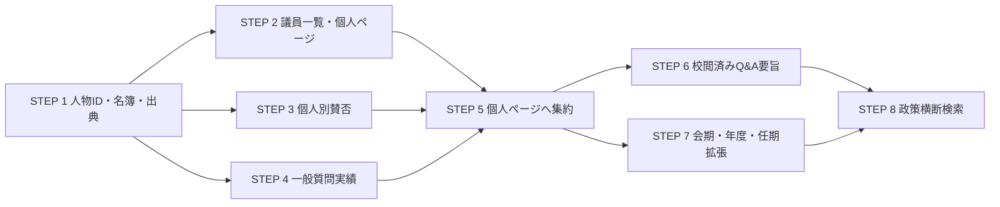

# みらい議会・三島市版：議員活動可視化 STEP 1～5 実装計画

作成基準日：2026年11月24日。**計画案・実装未着手・承認待ち**。

基点：`mishima-migration`、`6786d4bfad7e54aa0398fbcb1c6f81090b5d1ae4`。[実現可能性調査](20261124_1308_議員活動可視化機能の実現可能性調査.md)を前提とする。調査書だけを同コミットでpushし、PR #1（main向け、未マージ）への反映を確認済み。本計画はその後に作成した**未コミット文書**であり、今回承認されたpushには含めていない。

## 1. 目的・範囲・実装の単位

議員ID・日付付き議員名簿・出典台帳を、賛否と一般質問の共通基盤とする。同時に、基盤整備を長期の独立工程にせず、最初の開発単位でブラウザから議員一覧と個人ページを確認できる状態にする。

| 開発単位 | 含むSTEP | ブラウザで確認できる完成物 |
|---|---|---|
| A：最初の承認対象として推奨 | STEP 1＋2 | 議員22人の一覧、写真なしの個人ページ、所属の基準日、出典・未確認の表示 |
| B | STEP 3 | 確認済み9議案の個人票、集計、議案詳細、議員から辿れる賛否表示 |
| C | STEP 4＋5 | 6月の一般質問実績、議員別履歴、賛否と質問をまとめた活動ページ |
| D以降 | STEP 6～8 | 要旨、他会期・過去任期、政策横断検索。別途仕様・承認 |

各単位はローカルで受入可能な形まで完成させる。Preview確認はユーザーの別途デプロイ承認後のみ。各STEPごとに本番・Previewへ自動デプロイする計画ではない。

初期対象は既存構成と同じ**2026年度（2026年4月～2027年3月）のうち資料確認済み範囲**。現在の議案62件・会議録7日分は変更しない。暦年2026年の2月定例会、将来の2027年3月、任期全体を初期集計へ黙って含めない。

## 2. 依存関係と段階ごとの完了条件



実際の作業順はユーザー指定どおりSTEP 1→2→3→4→5。技術的にSTEP 3と4は共通基盤に依存するが、別々に着手・承認できる。STEP 6に必要な権利方針が未解決でも、STEP 1～5の事実・リンク中心の開発は分離して検討できる。ただし一般公開保留の解除とは別である。

### STEP 1：議員ID・日付付き名簿・出典台帳

- 22人の氏名・かな・期数・公式名簿へのリンクを確認し、不変IDを採番する。写真、自宅住所、年齢、私用連絡先は取り込まない。
- 議席番号・会派・委員会・期数は名簿スナップショットに持たせる。5月15日名簿、5月20日会派名簿、5月・9月の採決資料を区別する。
- 当時の所属を確認できない場合はnull／未確認にする。「資料基準日」を移籍・所属開始日へ変換しない。
- 「髙田／高田」「野村諒子／名簿HTMLの涼子」等は原表記を保持し、確認済み別名対応だけを登録する。自動的なあいまい一致で人物を確定しない。
- 出典台帳に資料名・公式URL・発行日／基準日・取得日・PDF頁／会議録ID・確認状態・利用範囲を保存する。本文は入れない。
- 出力をスキーマ・参照整合チェックに通す。データ確認結果をSTEP 2の画面に直接利用する。

**完了条件：** 22件の重複しないID、必要な出典参照の欠落なし、住所・写真等なし、当時所属不明を表現できること。人物の統合・別名対応一覧をユーザーに確認してもらう。将来の全任期を先に入力し終えることは条件にしない。

### STEP 2：議員一覧・議員別ページ

- `/members` に22人を名簿基準の議席順で表示する。表示基準日と公式名簿リンク、非公式・テスト公開の既存注意を維持する。
- `/members/[memberId]` に氏名、かな、資料時点の議席・会派・委員会・期数、確認済み任期情報と公式出典を表示する。
- データ未追加の活動欄は「賛否履歴は準備中」「一般質問実績は未集計」とし、0件や0回を出さない。
- トップの既存検索・議案一覧の順番を変えず、見つけやすい位置に「議員から探す」の導線を追加する。大規模な共通ヘッダー変更は初期必須にしない。
- 不正／存在しないIDは404。ページタイトルに議員名と非公式サイト名を含め、画像OGPや写真は追加しない。

**完了条件：** 22人全員のページへ一覧から移動できる。資料基準日・出典・未確認が見える。スマートフォン幅とキーボードで移動可能。STEP 1＋2を合わせて最初のブラウザ確認を行う。

### STEP 3：確認済み9議案の個人別賛否

- 対象：5月の承第5号、9月の認第1・2・3・4・8号、議第54・62・63号。
- 既存議案JSONとは別に安定したbill IDの対応表を追加する。元の番号・件名・結果・PDFリンクは変更しない。
- 採決イベントと22人の個人票を派生JSONとして追加する。全9件×22人=198セルを、原表と独立に二重照合する。
- `/votes` に議案選択、公式結果、人数・分母、個人別一覧を表示する。9議案のマトリクスも同じ確認済みデータで生成し、スマートフォンでは1議案ずつの一覧を使えるようにする。
- `/bills/[billId]` を**新しいJSON用の詳細ページ**として追加し、既存議案一覧の公式PDFリンクを残したまま詳細導線を追加する。旧DB依存の `_legacy/bills` は復活させない。
- 詳細ページは62件を解決できる対応表を持ち、個人表のない35件は「個人別賛否は資料未掲載」、結果未掲載18件は「議決結果は資料未掲載」とする。未掲載を未採決と断定しない。
- 既存62件と紐づかないID・会期の取り違えはビルド前チェックで失敗させる。全会一致からの個人票生成、会派態度の個人化、討論からの推定は行わない。
- STEP 3時点の個人ページに賛否一覧への導線を付け、STEP 5で期間別の統合表示を完成させる。

**完了条件：** 調査書の3議案サンプルと一致し、他6議案も承認済み。全62件を9／35／18の対象範囲で区別できる。認第1号の17賛成・3反対・1退席・1議長不参加が表示される。

### STEP 4：6月定例会の一般質問登壇者・履歴

- 一般質問の4日（6月18・19・22・23日）、16人・各1回を派生JSONとして整備する。会議録ID・日程ID・開始紹介／本人発言／終了の確認箇所を保持する。
- `/questions?session=mishima-2026-06-regular` に日別の実施者と議員ページ・公式会議録へのリンクを表示する。
- 初期表示は実施者・実施日・回数・出典のみ。通告テーマは「通告上の項目」であると表示できるが、初回実装では要旨や質問テーマ数の集計は追加しない。
- 一般質問枠が網羅された6月だけ、登壇しなかった6人を0回とする。9月は実績未照合、11月は調査基準日時点で予定とし、0にしない。
- 実装時点が調査日より後でも、スナップショットの基準日を表示し、古い「予定」を現在の事実として断定しない。他会期の実績更新は別途確認後に行う。
- 再質問・休憩再開を登壇回数に足さない。副議長の進行も抽出対象とする。自動パース結果をそのまま公開せず、初期16枠は手動照合する。

**完了条件：** 4日・各4人、16人・16回と一致。一般質問の種別を保持。公式リンクが開く。対象外の会期を0回と表示しない。

### STEP 5：議員別ページへ賛否と質問履歴を集約

- 一覧・詳細・履歴をすべて同じmemberIdで結合する。STEP 2の基本情報の下に「議案賛否」「一般質問」を並べる。
- 賛否集計は「個人票確認済み9議案の範囲」、一般質問は「6月4日を確認」と別の対象範囲を表示する。どちらも年度全体の完全な活動数と誤認させない。
- 年度・会期選択はURLに保持。初期は対応する2026年度だけを選択可能にする。未取得の年度・任期を空の0件として選択肢に出さない。
- 会派は「現在確認した所属」と「採決当時」を分離する。期間不明の過去所属を現在の所属で埋めない。
- 空状態は「確認済み範囲では該当なし」「資料未掲載」「未集計」「当時在籍外」を別表示する。
- 回数比較ランキング、活動スコア、政策成果の評価、未確認の討論要旨、AIの解説を追加しない。

**完了条件：** 22人のページで取得範囲が分かり、投票9件と6月の質問が同一人物に正しく紐づく。氏名変更や議席変更を想定したテストでもIDとURLが変わらない。

## 3. データ構造：小さなJSONから始める

公開用データの保存先案：`web/src/features/council-activity/server/data/`。既存原本ディレクトリとは分ける。全文・取得した紙面画像・写真は追加しない。公開派生JSONを読み込むRepositoryだけをアプリに接続する。

| ファイル案 | 内容 | STEP |
|---|---|---|
| `members.json` | 不変ID、表示名、かな、確認済み別表記、名簿リンク。個人の同定台帳 | 1 |
| `roster-snapshots.json` | snapshotId、基準日、memberId、議席、会派、委員会・役職、期数、任期の確認範囲、sourceRefs | 1 |
| `sources.json` | sourceId、資料名、URL、日付、取得日、内容ハッシュ、利用範囲・確認状態。本文なし | 1 |
| `2026/coverage.json` | 対象年度、会期、名簿／賛否／質問それぞれの取得範囲・基準日・完全性 | 1から段階更新 |
| `2026/bill-references.json` | 安定billId、sessionId、種別・番号、既存sourceUrlへの対応。元JSONを参照するキー | 3 |
| `2026/voting-events.json` | eventId、billIds、採決日、公式結果、出典・検証情報 | 3 |
| `2026/member-votes.json` | eventId＋memberId、賛否・参加状態、原記号、PDFセル、校閲状態 | 3 |
| `2026/question-appearances.json` | 実施ID、memberId、会期・日付、種別、予定／実施の状態、会議録範囲・公式URL | 4 |

最初からDB用の多数テーブルや管理画面を作らない。履歴の主語を共通IDにすることで、後でDBに移してもURLを変えずに済む。

### ID・期間・欠測の原則

- memberIdは氏名、議席番号、会派、任期に依存しない。一度公開したIDは再採番・再利用しない。採番は実装承認後に行い、本書では人物へ本番IDを割り当てない。
- sessionId例は `mishima-2026-06-regular`。billIdは会期・種別・番号を明示して対応させる。再提出や複数採決はeventIdで分ける。2025年議案47号と2026年議第47号を結合しない。
- 所属の `observedAt`（確認資料の基準日）と `validFrom/validTo`（実際の有効期間）は別。後者が不明ならnull。会派と政党を同じフィールドにしない。
- 期数は名簿の基準日時点の値。任期満了日が判明しても、開始日を未確認のまま生成しない。
- `coverage` は項目ごとの状態を持つ。投票データが未掲載でも、同じ議案の結果は既知という状態を表現する。

```typescript
// 提案型。アプリには追加していない。
type CoverageState =
  | "complete"           // 定義した範囲で確認済み
  | "partial"
  | "unreported"         // 資料に当該項目がない
  | "not_reviewed"       // 未照合
  | "not_yet_due"        // 基準日時点で開催前
  | "not_applicable";    // 当時非議員など

type Vote = {
  eventId: string;
  memberId: string;
  choice: "yes" | "no" | null;
  participation: "voted" | "absent" | "abstained" | "left"
    | "recused" | "chair_not_voting" | "unreported";
  observedMark: string;
  sourceId: string;
  locator: { pdfPage: number; printedPage: string; row: string; column: string };
  review: { status: "extracted" | "checked" | "approved"; checkedAt: string | null };
};

type QuestionAppearance = {
  id: string;
  memberId: string;
  sessionId: string;
  date: string;
  kind: "general_question";
  status: "confirmed";
  sourceId: string;
  councilId: number;
  scheduleId: number;
  introMinuteId: number;
  firstSpeakerMinuteId: number;
  endMinuteId: number;
};
```

`QuestionAppearance` は確認済み実施専用。将来の通告は別データとして扱い、この配列に予定を混在させない。初期版は9月・11月の個人別予定を入力せず、会期のcoverageで「実績未確認」と示すだけでもよい。

### 集計の意味

- 賛否の円・棒グラフを使う場合、明示的賛否人数と在籍者構成のどちらを分母にするか明示する。議長・退席を反対へ加算しない。
- 認第1号の賛否のみなら17/20=85%・3/20=15%。名簿22人の構成なら17・3・退席1・議長1の四区分。公式の認定結果を割合から再計算しない。
- 個人票が掲載された9件の履歴を表示しても、他の35件を賛成0／反対0へ変換しない。
- 実績は1質問枠=登壇1回。同枠の再質問・再答弁・休憩再開は加算しない。
- 6月は16人各1回・6人0回。他会期・年度・任期全体は未確認として区別する。
- 件数で議員を順位付けしない。取得対象が違う数値を比較グラフに並べない。

## 4. URL・ページ構成

| URL案 | 内容 | 既存への影響 |
|---|---|---|
| `/` | 現行の議案検索・一覧・会議録リンク。議員・賛否・質問への入口を追加 | 全62件初期表示、会議順、検索条件、公式PDFを維持 |
| `/members` | 議員一覧22人、基準日 | 新規 |
| `/members/[memberId]?fy=2026&session=...` | 基本情報＋対象期間の賛否・質問 | 新規。初期対応年度以外の値は説明付きで既定値へ |
| `/votes?session=...&bill=...&view=list` | 議案別個人票・集計・マトリクス | 新規。未知の条件は無視した旨を表示し、URL復元を検証 |
| `/bills/[billId]` | JSON版議案詳細・個人票と出典 | 新規。旧DB版を再有効化しない |
| `/questions?session=mishima-2026-06-regular` | 6月の日別実施一覧・議員別履歴導線 | 新規。STEP 4で要旨詳細ページは作らない |
| `/minutes/453-2` ほか既存7件 | 公式会議録へ案内 | パス・既存表示を維持 |
| `/questions/[questionId]` | 質問・答弁・再質問要旨 | STEP 6以降の予約案。STEP 1～5ではリンクを出さない |

会期ID・queryは許容値を検証し、不正なIDから任意ファイルを読む実装にしない。新しいCookie・localStorage・APIエンドポイントは初期実装で追加しない。URLだけで条件を共有・復元する。

## 5. 画面イメージ（設計用・未実装）

### STEP 1＋2の最初の表示

```text
みらい議会@三島市　　[議案へ戻る]
テスト公開中・三島市／三島市議会の非公式サイト

議員から探す                     全22人
名簿：2026年5月15日／会派：5月20日時点
[公式名簿] [出典と取得範囲]

秋山 恭亮　　改革みしま（確認時点）   [議員ページ]
沈 久美　　　改革みしま（確認時点）   [議員ページ]
… 22人を議席番号順に表示
```

### STEP 5の議員ページ

```text
秋山 恭亮
議席1／1期（2026年5月15日の名簿）
会派：改革みしま（資料基準日を表示）
委員会：福祉教育委員長 ほか     [公式出典]

対象：2026年度 [会期を選ぶ] [条件解除]
※表示範囲のデータであり、議員活動全体の評価ではありません。

議案賛否
個人票を確認した9議案のうち対象○件
[議案名] [賛成等の記号＋文言] [採決日] [出典]
その他の議案には個人票未掲載・結果未掲載があります。

一般質問
6月定例会：1回／確認対象4日
2026-06-18 [公式会議録を確認]
9月：実績未照合（取得基準日を表示）
※質問テーマ数・再質問回数・要旨は現段階の集計対象外
```

### 議案詳細・マトリクス

```text
認第1号　一般会計決算認定
公式結果：認定／採決日：2026-10-02
賛成17・反対3・退席1・議長不参加1
[公式の議案資料] [個人票のPDF・印刷7頁]

議員         賛否／参加状態
弓場 重明    退：退席
本間 雄次郎  ×：反対
岡田 美喜子  議：議長不参加
… 全員を同じ基準で表示

[一覧] [マトリクス]
縦：議員／横：9議案。色＋記号＋読み上げ用文言
```

上記の人物・票数は調査書の実例、ID・URL・UIは設計案。サンプルの3人だけを公開対象に選別することはしない。画面は全員同じ基準で作る。

## 6. 追加・変更予定ファイル

以下は予定であり、現時点で追加したアプリファイルはない。新機能は `council-activity` Featureにまとめ、既存のDB依存 `general-questions` と取り違えない。部品分割は実装時に重複を避けて調整する。

### STEP 1：共通の型・派生データ・検証

- 新規 `web/src/features/council-activity/server/data/` 配下の3基礎JSONと `2026/coverage.json`。
- 新規 `web/src/features/council-activity/shared/types/council-activity.ts`：人物・出典・名簿・coverageの型。
- 新規 `web/src/features/council-activity/shared/utils/validate-activity-data.ts` と `.test.ts`：スキーマ、ID、参照、重複、対象期間、公開禁止フィールドの検証。既存zodが適合すれば利用し、新規依存は不要。
- 新規 `web/src/features/council-activity/server/repositories/council-activity-repository.ts`：`server-only`、静的JSON読取り。全文JSON・DB・AIをimportしない。
- 新規 `packages/seed/mishima/utils/activity-snapshot.test.ts`：既存議案との対応・確認済み期待値・派生データの整合を読み取り検証。seedやDB投入ではない。

### STEP 2：最初のブラウザ画面

- 新規 `web/src/app/(main)/members/page.tsx`。
- 新規 `web/src/app/(main)/members/[memberId]/page.tsx`。
- 新規 `web/src/features/council-activity/server/components/member-list-view.tsx`、`member-detail-view.tsx`、`source-reference.tsx`、`coverage-notice.tsx`。
- 新規 `web/src/features/council-activity/shared/utils/member-profile.ts` と `.test.ts`：基準日時点の表示データ生成。
- 変更 `web/src/features/official-records/server/components/official-records-view.tsx`：議員一覧への入口のみ。この段階では既存検索処理を変更しない。

### STEP 3：個人票・議案詳細

- 新規 `server/data/2026/bill-references.json`、`voting-events.json`、`member-votes.json`。
- 新規 `web/src/app/(main)/votes/page.tsx`、`web/src/app/(main)/bills/[billId]/page.tsx`。
- 新規 Feature内 `server/components/vote-list-view.tsx`、`vote-matrix-view.tsx`、`official-bill-detail-view.tsx`。
- 新規 `shared/utils/vote-summary.ts`、`vote-matrix.ts`、`bill-reference.ts` と各 `.test.ts`。
- 変更 Featureの共通型・Repository・検証・coverageと、既存 `official-records-view.tsx` の詳細導線。
- 既存の公式PDFのアンカーを詳細ページリンクに置き換えず、両方を設置する。

### STEP 4：一般質問実施履歴

- 新規 `server/data/2026/question-appearances.json`。
- 新規 `web/src/app/(main)/questions/page.tsx`。
- 新規 Feature内 `server/components/question-history-view.tsx`。
- 新規 `shared/utils/question-appearance-summary.ts` と `.test.ts`。
- 変更 共通型・Repository・検証・coverage・トップの質問入口。

### STEP 5：統合・期間選択・URL

- 変更 `member-detail-view.tsx`、`member-profile.ts`：賛否と質問を集約する。
- 新規 Feature内 `shared/utils/activity-filters.ts` と `.test.ts`：URL許容値・絞り込み・未確認の扱い。
- 新規 Feature内 `server/components/activity-filter-form.tsx`：GETフォームを第一候補とし、Client状態を必要最小限にする。
- 新規 Feature内 `server/components/member-activity-view.test.tsx`：意味のある空状態・出典・対象範囲の表示テスト。`server-only` をモックする必要がある場合は表示用の純粋なprops変換をsharedへ切り出す。
- 変更 `scripts/public/publication.test.cjs`：新ページの非公式表示・外部スクリプト不在・本文漏出なし・既存URLを追加確認。
- 新規 `docs/YYYYMMDD_HHMM_議員活動機能受入検証記録.md`：各段階の確認結果、未確認、対象コミットを記録。

データ読取りはServer Componentsを標準にし、各pageはparams／searchParamsの取得とFeatureへの受け渡しに限る。新しいexport集約 `index.ts` は作らない。Button・色トークン・lucideの既存ルールを守る。グラフは必須ではなく、最初は人数と同値の表で十分。

### 変更しない対象

既存の `official-records/server/data/2026/` 全10ファイル、会議録本文、DBスキーマ・seed実行処理、AI設定、Vercel設定、GitHub設定、ライセンス、元画像は本機能の通常変更範囲外。`package.json`、lockfile、新しいAPI・写真も初期追加予定に含めない。既存の `_legacy` は有効化しない。

`.vercelignore` は既存本文除外を維持する。新しい派生JSONは内容審査後にビルド入力へ含めるが、原PDF・取得本文を入れない。設定変更が必要と判明した場合は、別途説明・承認する。CIや一般公開監査の改修を本機能に便乗させない。

## 7. 既存機能への影響・回帰対策

| 既存機能 | 維持すること | 検証 |
|---|---|---|
| トップの議案一覧・検索 | 初期62件、会議順・議案順、AND検索、表記ゆれ、URL条件、条件解除 | 既存テスト＋本番モードで補正予算15件、11月併用5件、解除62件 |
| 公式PDF・会議録 | 既存URL・リンク文言・別タブ遷移、本文非掲載 | 62件のリンク対応と既存7ページ、新9議案の出典を確認 |
| 注意書き・運営者・規約 | 非公式・テスト公開、既存運営者表示、AGPL | HTTP検証を新ページにも拡張 |
| DBなしビルド | 新ページがSupabaseや有料AIへ接続しない | DB未起動の型チェック・テスト・本番ビルド。旧ルート復活なし |
| 認証・配信 | 現在の保護設定は維持。本機能で認証解除しない | Previewを別途承認された際に新旧ルート・静的資産・APIの匿名遮断を検証 |
| メタデータ | 新ページは写真なし・非公式を識別。既存OGP・canonical監査は別管理 | ページタイトルと個人名の安全な出力を確認 |

新規ディレクトリを通じた住所・全文の意図しない配信も防ぐ。実装時にはサーバーレンダリングHTMLだけでなくRSC・静的成果物のデータにも、公開対象外情報が含まれないことを確認する。

## 8. テスト計画

### データ・純粋関数

- memberId重複・不明参照・別名衝突・会派と政党の混同・名簿日と所属開始日の混同を検出。
- 全9件の198セル、出典頁、集計の人数、議長不参加・退席・欠席・棄権・除斥・不明を区別。該当種類のない実データには明示的な合成テストを使う。
- 公式結果を多数決の式から上書きしない。2025年と2026年の同番号が結合されない。
- 62件は9件個人表あり／35件個人表なし／18件結果未掲載という基点の期待値を検証。将来更新時は根拠付きで期待値を改訂する。
- 6月16枠、同一枠の複数発言・再質問・休憩が登壇回数を増やさないこと。副議長の進行を取りこぼさない。
- 6月0回と、他会期の未確認・開催前・在籍外を区別。未確認の年度合計を確定値として返さない。
- 年度・会期の組合せ、未知query、全解除、複数条件、URL保持を検証。

### ページ・操作

- 一覧から22人全員の詳細へ到達、不明IDは404、各出典・凡例・対象範囲を表示。
- 空状態を0と誤表示しない。票数・質問数で順位付けしない。
- キーボードのみで一覧・絞り込み・詳細・公式リンクを操作。フォーカスとフォームラベルを確認。
- 375px程度の幅、200%拡大、横長表、長い氏名・件名、スクリーンリーダー用見出しを確認。新たな縮小固定を追加しない。
- ブラウザの戻る／進む・再読み込みで条件復元。スマートフォン実機は本人確認と記録する。
- 既存の検索・公式PDF・会議録7ページが壊れていないこと。

### ローカルの品質ゲート（実装後に実行）

```powershell
.\mishima.cmd pnpm lint
.\mishima.cmd pnpm typecheck
.\mishima.cmd pnpm test
.\mishima.cmd pnpm build:web
# 成功した本番ビルドを起動してHTTP検証。DB起動・seedは不要。
.\mishima.cmd pnpm --filter web start --port 3002
# 別ターミナルで実行
.\mishima.cmd pnpm test:public
```

既存の警告は新規不具合と区別して報告し、本機能のために関係のないコードを無断修正しない。本番ビルド・HTTP検証を通してからコミット・pushの承認を求める。実装用レビューの手順が必要な場合も、ユーザーの個別承認範囲を超えてpushやPR操作を行わない。

## 9. データ品質の校閲・受入基準

1. 公式出典の基準日と取得版を固定する。公開用JSONに根拠箇所を必須にする。
2. 22人と別表記を独立確認し、ユーザーへ人物対応一覧を提示する。
3. 票は原表の氏名列順・記号・斜線・凡例を確認して二重照合する。検証者は同じ抽出結果を眺めるだけでなく、原PDFから確認する。
4. 6月の質問は議題・紹介・本人発言・終了を確認。通告と一致するか記録し、変更・欠測があれば未確認のまま残す。
5. `approved` のみを公開表示対象とする。未承認票を除外したことで0に見える場合は必ずcoverageを表示する。開発中の候補と本番配布データを混ぜない。
6. 話者・範囲・日付・役職・所属の不一致は、推測で修正せず差分を報告。調査書のサンプルも本番採用前に校閲する。
7. 訂正は対象ID・旧新値・理由・出典・日付を記録し、関係する集計とリンクを再テストする。原本とGit履歴は変更しない。

合成テストデータはテスト内だけに置き、実在議員の架空の賛否を本番データへ混ぜない。実装時の人物IDは台帳から解決し、PDF列番号や議席番号をそのままIDとして使わない。

## 10. 開発工数の見込み

1人日8時間、経験のある開発者1人、初期22人・9議案・6月16枠、ローカルテスト・確認を含む暫定値。外部確認待ちとユーザー確認待ち、デプロイ作業は別。

| 段階 | 工数 | 終了時に見えるもの |
|---|---:|---|
| STEP 1 | 1.5～2.5人日 | 型・小さなJSON・参照検証。単独で長期間継続しない |
| STEP 2 | 1.5～2.5人日 | **合計3～5人日で議員一覧・個人ページ** |
| STEP 3 | 5～8人日 | 9議案の個人票・マトリクス・新しい議案詳細。データ校閲を含む |
| STEP 4 | 3～5人日 | 6月16人の一般質問実施一覧・公式リンク |
| STEP 5 | 2～4人日 | 議員ページへの統合、期間条件・範囲表示 |
| 合計 | **13～22人日** | STEP 1～5の初期版。公開判断は別 |

調査書の大まかな見積りを、実装範囲を絞って分割した値。自動取得汎用化・過去全期間・写真・要旨・DB・AIは含まない。基盤＋最初の画面までをA単位として確認し、B・Cはその結果で再見積りする。追加の有料サービス費は予定しないが、本人の校閲時間・既存ホストの利用枠は別途必要。

STEP 6は、質問・答弁の対応単位、要旨の権利・校閲、複数答弁者、再質問を別途設計する。STEP 7は名簿履歴と資料網羅性を確認して会期単位で拡張。STEP 8は共通の政策テーマIDと分類基準を定め、要旨や取得範囲の違いを明示する。いずれも今回の実装承認対象には含めない。

## 11. Previewでの本人確認方法（将来の別途承認後）

今回はデプロイしない。ローカルでの最初の確認先は `http://localhost:3002/members`。実装されるまでは存在しない予定URLである。

Previewを作る場合は、その時点で対象コミット、作業ツリー、Vercelチーム・プロジェクトID、認証保護範囲・例外、ProductionのデプロイIDを読み戻す。ユーザーの明示承認後に限りGit未接続のCLI Previewを行い、Productionは変更しない。保護状態が不明なら停止する。今回の承認をデプロイ承認として扱わない。

| 確認 | 本人がブラウザで行う操作・期待値 |
|---|---|
| 最初の画面 | Vercelへログインし `/members`。22人、基準日、非公式表示を確認 |
| 全員への導線 | 一覧から議員ページへ移動。氏名・かな・期数・所属・出典を確認。不明を0と表示しない |
| 採決例 | 認第1号を開き、17賛成・3反対・1退席・1議長不参加。弓場氏の退席、本間氏の反対、岡田氏の不参加を公式PDFと照合 |
| 既存機能 | 補正予算15件、11月併用5件、解除62件。議案PDF・会議録リンクが開く |
| 質問例 | 6月18日が秋山・本間・野村・服部の4人。秋山氏は6月1回。他会期未確認を0にしない |
| 統合 | 同じ議員の賛否・質問・出典が表示され、年度全体の完全な評価に見えない |
| 状態復元 | 条件変更→再読み込み→戻る→進むで条件・件数が整合 |
| 実機 | スマートフォンで表とカード、拡大、公式リンク、縦横スクロールを確認 |

Codex側はLinuxビルド、匿名アクセス遮断、HTML・リンク・対象範囲の自動検証、Production不変を確認する。ログイン済みブラウザを操作できない場合は本人確認を依頼する。本人未確認は未確認のまま検証記録に残す。匿名漏出等の緊急対応は、そのデプロイ承認時の許可範囲に従い、無断の設定変更・再デプロイを行わない。

## 12. 一般公開前監査との分離管理

本機能の受入条件と、[一般公開前監査](20261116_1642_一般公開前最終監査.md)の解消条件を別のチェックリストで追う。

| 管理枠 | 対象 | 本計画での扱い |
|---|---|---|
| 機能開発 | 人物ID、名簿、個人票、一般質問実績、統合UI、テスト | STEP 1～5の承認後に開発 |
| 権利・公開監査 | 公開GitHubの全文JSONと履歴、画像の権利、Cookieと記載、viewport、OGP・canonical・robots、CI、実Production・実機の未確認 | **未解決を維持。別途対応を承認する** |
| 運用・デプロイ | 保護設定、Preview・Production、Git連携、一般公開 | 本計画では実行しない |

新しい公開用データに全文・写真等を持ち込まないことは本機能の条件だが、既存の全文GitHub公開を解決した扱いにはしない。新機能が完成しても一般公開は自動的に可能にならない。

## 13. 今回の実行記録と次の承認

今回実行したこと：

- 承認済み調査文書1ファイルだけを `6786d4bfad7e54aa0398fbcb1c6f81090b5d1ae4` としてコミット・push。
- GitHub APIでPR #1の先端が同SHA、open・未マージ・main向けであること、コミット対象が指定文書1ファイルのみであることを確認。
- push直後の作業ツリーはクリーン。その後、新規の本計画文書1ファイルを作成したため、最終状態では本書が未追跡で残る予定。
- push前に `pnpm lint` 成功（既存adminコードのnon-null assertion警告11件、修正なし）、`pnpm typecheck` 成功、`pnpm test` 全1,218件成功（Windows10、shared10、seed52、admin233、web913）。
- GitHubの当該コミットのcheck-runsは確認時0件。ローカル検証成功をGitHub CI成功とは呼ばない。
- コミット時の氏名未設定は、既存履歴と同じ氏名・メールを `git -c` に限り指定して対応。PC・リポジトリの永続Git設定は変更していない。フックはMarkdownが対象外との案内で正常終了。
- 本番ビルド・HTTPテストは今回新規に実行していない。実装後の必須検証として8節に計画した。

**次に求める承認：開発単位A（STEP 1＋2）の実装開始。** まず一覧と個人ページをローカルで確認できる成果を提示する。STEP 3以降の着手、コミット・push、Previewデプロイ、Production反映、一般公開は別途承認を得る。本計画文書のコミット・pushも今回の調査書pushの承認には含めず、別途承認待ちとする。
